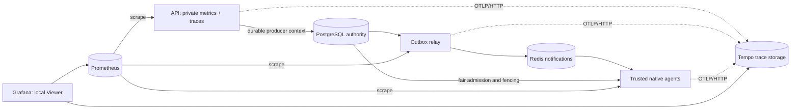

# Local observability and operator runbook

Metrics summarize populations; traces explain causally related work; logs record selected events. A counter increases until its process restarts, a gauge reports current/cached state, and a histogram records observations into cumulative buckets. Prometheus `rate` handles counter resets; histogram quantiles must aggregate buckets across instances before computing the quantile. Averaging separate instance p95 values is incorrect.



## Start and verify

Follow [local web](local-web.md) and [agent](execution-agent.md) prerequisites. Never expose this overlay publicly. Use a separately provisioned test schema/stream for experiments, as described in [load testing](load-testing.md).

```sh
docker compose -f docker-compose.yml -f infra/local-judge.compose.yml -f infra/local-web.compose.yml -f infra/observability.compose.yml --profile outbox --profile observability up -d
python scripts/observability-smoke.py
```

The overlay enables application telemetry in explicit development mode. `OBS_DATABASE_URL` can point API/relay at the isolated schema; it does not alter PostgreSQL authority. Apply/check migrations using that same database URL before startup. The relay still requires its existing explicit OUTBOX_RELAY_ENABLED flag and isolated OUTBOX_STREAM. The web overlay supplies local cookie authentication; no privileged browser key is introduced.

Local endpoints are Grafana `http://localhost:13000`, Prometheus `http://localhost:19090`, Tempo query/readiness `http://localhost:13200`, and OTLP HTTP `http://127.0.0.1:14318`. The optional API metrics port is loopback `19091`; relay `9092` is container-private. The public API's `/metrics` remains absent.

For each trusted host agent set APP_ENV=development, TELEMETRY_ENABLED=true, TELEMETRY_OTLP_URL=http://127.0.0.1:14318 and TELEMETRY_ADDR=127.0.0.1:19093 (second agent: 19094). Existing execution/fair-mode authorization remains mandatory. Docker Desktop Prometheus reaches these through host.docker.internal; the actual local demonstration verified both targets UP. A native listener must be loopback unless the explicitly private container-network setting is enabled. Do not use that exception to expose host metrics.

The smoke script checks readiness, Grafana provisioning/data-source health, explicit API/relay scrape targets and real PromQL results. It reports agent target status as observed, including deliberately stopped agents. Graphical inspection is a separate check and is not implied by successful JSON provisioning or queries.

## Metric contract

| Metric | Population / units |
| --- | --- |
| `judgegrid_http_requests_total` | Completed HTTP responses by bounded route, method, status class and service |
| `judgegrid_http_duration_seconds` | Handler entry through response completion; events route includes stream lifetime |
| `judgegrid_operations_total` | Physical operation completions by bounded operation/outcome/language; accepted and terminal mark committed logical transitions, duplicates are separate |
| `judgegrid_duration_seconds` | Monotonic local operation durations or explicitly named timestamp estimates |
| `judgegrid_state` | Cached outbox/scheduler/lease/SSE counts plus dimensionless snapshot health/truncation |
| `judgegrid_outbox_oldest_pending_seconds` | Database-time age of oldest sampled pending/claimed intent |
| `judgegrid_snapshot_updated_timestamp_seconds` | Last successful inventory's Unix timestamp; subtract from `time()` to check freshness |

Operations cover creation, authorization, relay claim/publication/retry, Redis processing/duplicate handling, scheduler polling/admission, lease claim/renew/failure, bundle fetch/verification, cache lookup/build/hit/miss/publish/restore, workspace/compile/run/cleanup, judging, result persistence, SSE connect/reconnect/replay/reset/write/slow/disconnect and reconciliation. `sandbox.timeout` is a separate marker, not a second physical run. A controlled CE/WA/TLE is a genuine user verdict; it is not automatically an infrastructure error. `fence.reject` counts refused stale authority where identified. Unsupported legacy Go acceptance can terminate FAILED without launching a sandbox.

Prometheus automatically adds configured instance/job labels; applications never label by submission ID, account, source hash, object key, trace ID, raw exception, full URL or arbitrary request text. Unknown categories collapse to `other`. The cardinality test supplies 1000 arbitrary values and verifies they create one normalized series.

Only the API collects shared database state. One five-second poll has a one-second deadline; there are no database calls in scrape handlers. Each status/inventory is bounded to 10001 rows and `snapshot_capped=1` marks lower-bound counts. Failed snapshots retain prior values with `snapshot_ok=0`; last-success timestamp reveals stale data. Do not interpret a stale/capped inventory as an exact cluster count.

Example queries:

```promql
# Aggregate bucket rates first; p50/p95/p99 substitute 0.50/0.95/0.99.
histogram_quantile(0.95, sum by (le, route) (
  rate(judgegrid_http_duration_seconds_bucket{route!="events"}[5m])))

sum by (outcome) (rate(judgegrid_operations_total{operation="terminal"}[5m]))
sum(rate(judgegrid_operations_total{operation="cache.hit"}[5m]))
 / clamp_min(sum(rate(judgegrid_operations_total{operation=~"cache.hit|cache.miss"}[5m])), 0.001)
time() - judgegrid_snapshot_updated_timestamp_seconds
```

Buckets span 1 ms through 300 seconds and +Inf. Tiny samples make p99 approximately the slowest sample; overflow estimates are censored by the last finite bucket. Show count alongside every quantile. Missing series means no observation, not zero latency. An exporter failure can lose telemetry, while committed PostgreSQL outcomes remain intact.

## Timing boundaries

| Phase | Start → end | Interpretation |
| --- | --- | --- |
| HTTP | middleware entry → handler completion | Includes auth/body/response; SSE connection duration is separate from normal requests |
| create | repository entry → transaction return | Includes idempotency/admission and durable intent commit |
| outbox_delay | outbox created_at → successful publication record | Timestamp estimate includes acceptance transaction and publication/record overhead |
| accepted_admission | logical intent created_at → successful ownership claim return | Initial/rejudge intent, not original submission creation for all rejudges |
| eligible_admission | published_at → successful claim return | Published-intent estimate, not exact continuously eligible time during retry backoff |
| claimed_start | run started_at → observed first preparation/compiler phase | Database/controller estimate including setup and bundle work |
| bundle.fetch / verify | trusted load / integrity call entry → return | No keys/test bytes attached |
| sandbox.workspace | Prepare entry → artifact/compile result return | Encloses cache/compile work; never sum with its children |
| cache.lookup / restore | claim and verified read / private restore phase → return | A hit restore is not compiler execution |
| sandbox.compile / run | controlled phase entry → result | Includes Docker creation/policy/attach/observation overhead |
| sandbox.attached | Docker attach/start → command completion | Existing measured controller wall interval, not CPU time |
| result.persist | finalization repository entry → return | Includes fenced transaction commit/replay |
| accepted_terminal | logical intent timestamp → committed terminal observation | Cross-clock estimate; SQL load evidence also measures DB updated_at−created_at |
| sse.delivery | journal created_at → successful server frame flush | Includes commit; server flush does not prove browser receipt |

Local intervals use Go monotonic clocks. Timestamp-derived estimates can include commit delay and host clock skew; negative differences are omitted and counted. They are not additive with overlapping local spans. CPU and peak-memory measurements remain unavailable/null. Logical jobs, physical attempts, original submissions and rejudge scopes remain distinct.

## Trace diagnosis

Select a trusted `observed operation` log's trace_id, then use Grafana Explore → Tempo → trace ID. A processing trace links to the producer trace; follow that link to HTTP creation and compare relay/admission/lease/bundle/cache/phase/persistence intervals. An offline operator can resolve the producer from `outbox_events.traceparent` for an authorized scope. Duplicate physical attempts retain the same durable producer context and produce separate spans. Do not treat a trace ID as a credential or expose a public trace-debug route.

## Runbook

The provisioned alerts are demonstration thresholds, not production SLOs. `OutboxOld` (>30s for 30s): inspect relay/Redis and oldest durable intent; restore dependencies before trusted retry. `InfrastructureErrors`: inspect agent/bundle/cache/authority traces, distinguish user verdicts from infrastructure failure. `ExpiredExecutionLeases`: inspect heartbeat/recovery and run the trusted reconciler in dry-run first; never revive an expired owner. `StaleFenceWrites`: inspect duplicate controllers and generation changes, retain the fence. `AdmissionBacklog`: inspect cap saturation and fair scope coverage; reduce offered load rather than bypass admission. `TelemetryTargetDown`: distinguish an intentionally stopped demo agent from work failure; verify private bind/network and exporter counters. `TerminalLatency`: inspect sample count, workload mix, pending waits and child phase intervals before changing limits.

Example development SLIs: supported accepted logical jobs reaching genuine committed verdict / supported accepted jobs; fraction of that population terminal within 60s; HTTP 2xx / (2xx+5xx) with admission 429/503 reported separately; SSE reconnects recovering authoritative state / reconnect attempts. An illustrative SLO is 99% within 60s over a specified supported workload/window. Its 1% error budget permits 100 violations in 10000 jobs. Terminal FAILED and correct WA are different availability outcomes. These tiny laptop experiments establish neither that target nor an SLA/contract. Counter telemetry is best-effort; use durable SQL cohorts for reliability accounting, especially across process restarts and one-shot administrative commands.

Stop owned agents/relay after drain, stop only the named observability services, and restore ordinary Compose without this overlay. Preserve data and unknown resources. No instrumentation feature authorizes cleanup or overrides fencing.
