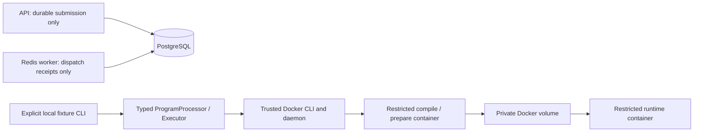

# Sandbox threat model and operating boundary

## Trusted components

The local fixture controller, its Go binary/source, runtime Dockerfiles/setup scripts, pinned images, vendored seccomp profile, Docker CLI/daemon, runtime and Linux kernel are trusted. The developer account can already control Docker. The local manifest is configuration controlled by that developer, not an untrusted request field. No public controller service exists.

Untrusted inputs are source code, program stdin and resulting program/compiler processes/output. Programs may loop, sleep, allocate memory, spawn children, print excessively or try to inspect files/networks. They receive no API/Redis/PostgreSQL credentials, host environment, host bind directories or daemon socket. Fixed filenames and private generated volume/container names keep source from selecting paths or command arguments.

## Authority separation

There is no Redis-to-executor or HTTP-execute arrow. Docker daemon access is absent from API/worker containers. The local controller's daemon access is still highly privileged authority: fixed CLI code does not downgrade the account's Docker permissions. Keep it local and use disposable/dedicated execution infrastructure for future deployment.

## Controls and what they do not prove

| Control | Intended protection | Limit |
| --- | --- | --- |
| Non-root, no capabilities, no-new-privileges | Reduce process privilege | No user-namespace remapping is claimed |
| Explicit seccomp allowlist | Reduce syscall surface | Broad runtime-compatible policy, shared kernel remains trusted |
| Private PID/IPC/cgroup views | Separate resource visibility | Namespace configuration is not VM isolation |
| CPU quota | Bound CPU allocation rate | Does not enforce elapsed-time completion |
| Memory/swap/PID limits | Bound charged memory/tasks | OOMKilled evidence is required for confirmed OOM classification |
| Controller deadline and container watchdog | Stop elapsed-time overruns and descendants | Host/daemon/kernel failure can defeat timely termination |
| Read-only root/runtime workspace | Restrict writes and cross-phase artifacts | Private named volumes need cleanup and are not aggregate disk quotas |
| Network none | Remove ordinary external/service connectivity | A compromised kernel/runtime remains outside this guarantee |
| Incremental combined output cap | Bound controller capture memory | Output is terminated after detection, not guaranteed byte-perfect timing |
| Offline pinned images | Prevent execution-time dependency downloads | Trusted images still require updates and review |

Secrets are never passed by the request contract, and engine configuration is checked against a small environment allowlist. Do not add env-file passthrough, arbitrary mounts, raw shell commands, privileged mode, host namespaces, public execution endpoints or unsafe host-execution fallbacks.

## Failure and cleanup

Ordinary compile errors and runtime exits are program outcomes. Missing images, daemon errors, unsupported isolation controls and startup/cleanup failures are infrastructure errors. Cancellation explicitly kills/removes the container namespace. Resource observations are labeled: wall time is controller elapsed time; CPU and peak-memory values are unavailable/null. General syscall-denial attribution is unavailable; a caught EPERM from an approved fixture is evidence for that fixture, not proof of all sandbox behavior.

The controller cleans every owned sandbox after successful, failing, timed-out or canceled execution. It preserves cleanup errors if Docker becomes unreachable. A separate in-container watchdog limits computation after abrupt controller loss, but stopped resources can remain after a hard crash and need operator reconciliation. Do not broadly delete resources belonging to other workloads.

## Non-goals

This milestone does not prove arbitrary-hostile-code safety, kernel-exploit resistance, side-channel isolation, production authentication, multitenant fairness, durable executor leases, worker fencing, reliable queue publication, hidden-test evaluation or a complete online judge. No public arbitrary-code service should be inferred from this development harness.

Relevant primary documentation: [Docker seccomp](https://docs.docker.com/engine/security/seccomp/), [resource constraints](https://docs.docker.com/engine/containers/resource_constraints/), [Docker daemon attack surface](https://docs.docker.com/engine/security/#docker-daemon-attack-surface).
