# Session 4 completion report

## Architecture and scope

Implemented a typed C++17/Python execution subsystem and an explicitly enabled local fixture CLI. The runtime backend is Docker's Linux engine, controlled by the trusted developer-side CLI. API/worker runtime images do not include sandbox-demo, receive no Docker socket/daemon endpoint, and expose no public execute route. Production submission consumption remains disabled; real submissions are not changed by execution fixtures.

```mermaid
flowchart LR
    Local[Opt-in local fixture CLI] --> Processor[Typed ProgramProcessor]
    Processor --> Executor[execution.Executor]
    Executor --> Engine[Trusted local Docker CLI / daemon]
    Engine --> Compile[Restricted compile or preparation container]
    Compile --> Work[Private Docker volume]
    Work --> Run[Restricted runtime container]
    Run --> Result[Phase outcomes and cleanup evidence]
```

Requests separate bounded source/stdin, language, compile budgets and runtime budgets. Results separate preparation/compilation/runtime, image identity, policy, exit status, bounded output, controller elapsed time and OOMKilled evidence. Program failures are outcomes; engine/image/policy/startup/cleanup failures are typed InfrastructureError values. ProgramProcessor has no database, verdict or ACK-writing authority. Existing Redis handlers never call it.

## Runtime environment and identities

Observed locally: Docker Desktop server 29.9.2, Linux x86_64 kernel `6.18.54.1-microsoft-standard-WSL2`, cgroup v2, working CPU quota/memory/swap/PID support and seccomp. Tests ran through a native Windows controller against that Linux VM. A separate Ubuntu/WSL installation was not required. Docker's internal docker-desktop WSL distro does not support running its CLI directly, so no such unsupported arrangement is used.

Trusted runtime setup selected GCC 14.3.0 and Python 3.13.17. Original local immutable identities:

- C++ runtime: `sha256:b8b2c5dcdf1884533d7123f61f7263d417fd78cfab861cda0e554e8c74dd1169`.
- Python runtime: `sha256:240510229e41a1b9ea7fee1843fb3b6e80d6d91ad339b023bf61db21fb1e7b6d`.
- GCC base: `gcc@sha256:5e927c284bf55a7dc796262e311a0703344f62f41f5621eb56843111b1d37e15`.
- Python base: `python@sha256:e32be0e55814a08977501ca863271d9bd02443710db8f2afaf8372e2c4508530`.

Machine-local runtime identities live in an ignored manifest. Setup can prefetch/build trusted images; execution uses --pull never and performs no dependency installation. The unchanged vendored Moby seccomp profile is pinned to commit `6fe7deb1b9fb7c0397a4593480d7d22b9ee8caef` and SHA-256 `6416b47770785a41ac59073cdc77d9fe98517df2799dc83ef207e622de3053f6`, with its upstream license preserved.

## Controls and evidence

All phases use non-root 10001:10001, dropped capabilities, no-new-privileges, verified seccomp, private namespace views, read-only rootfs, network none, one CPU's allocation, memory/swap bounds, 16-task limit, restrictive ulimits, bounded tmpfs and Docker logging disabled. Source uses fixed filenames and stdin; a private managed volume carries artifacts, with read-only runtime access. No host bind directory, credentials or arbitrary host command is exposed. Retained engine configuration and an environment allowlist are checked before starting a phase.

| Control | Actual evidence versus configuration |
| --- | --- |
| Non-root/capabilities/no-new-privileges/seccomp | Runtime fixture observed UID 10001, CapEff 0, NoNewPrivs 1, Seccomp 2; libc unshare returned EPERM |
| Memory | 256 MiB allocation attempt under a 64 MiB cgroup limit was killed, exit 137 with Docker OOMKilled=true |
| PID limit | Controlled child creation hit EAGAIN under 16-task budget, then children were reaped |
| Runtime wall deadline | Infinite C++ loop and 20-second Python sleeper were terminated under their 3-second phase budgets |
| Independent watchdog | A 20-second sleeper stopped under a 200ms container budget without the host execution timer |
| Output budgets | Both stdout/stderr floods terminated with 65,536 combined bytes retained; compiler diagnostics bounded at 128 bytes |
| Network | External numeric-IP connection failed under network none |
| Filesystem/secrets | Rootfs/workspace writes denied, unavailable host/socket paths and shadow read denied, host secret/API/Redis environment absent |
| CPU/memory/PID cgroup settings | Runtime read cpu.max=100000 100000, memory.max=67108864 and pids.max=16; CPU throughput and peak-memory sampling were not measured |
| Cancellation/cleanup | Active runtime canceled; all generated phase containers and private volume gone afterward |
| Concurrency | Four requests observed peak two active whole-execution slots |
| IPC/cgroup namespace, tmpfs flags, file/core/FD limits | Configured and engine-retention inspected where applicable; not every individual control has a dedicated exploitation test |

Default compile/preparation limits: 15 seconds, 256 MiB, 64 KiB combined output. Default runtime: 3 seconds, 64 MiB, 64 KiB combined output. Source/stdin each at most 64 KiB. Max configured local controller slots is four; demo uses two.

Sample final-run controller phase timings (include Docker attach/start/termination overhead, not pure CPU time): C++ Hello 327ms, Python Hello 400ms, C++ infinite loop 3.76s, Python sleeper 3.31s, confirmed OOM 822ms. Deadline triggers are followed by termination/collection latency; these are not hard real-time guarantees. CPU time and peak memory remain null/unavailable. General syscall-denial attribution is unavailable, and exit 137 alone is never treated as confirmed OOM.

## Executed test matrix

The final native Windows sandbox run passed **22 scenarios across 8 test functions: 22 pass, 0 fail, 0 skip**.

| Scenario | Result |
| --- | --- |
| Valid C++17 compile/run | Passed, stdout 5 newline, exit 0 |
| Valid Python preparation/run | Passed, stdout 5 newline, exit 0 |
| C++ syntax error | Passed, compile nonzero; runtime not started |
| Infinite CPU loop | Passed, wall_timeout |
| Sleeping program | Passed, wall_timeout |
| Controlled memory exhaustion | Passed, confirmed_oom with daemon evidence |
| Controlled process creation | Passed, EAGAIN at PID limit |
| Excessive stdout | Passed, output_limit and bounded capture |
| Excessive stderr | Passed, output_limit and bounded capture |
| External network attempt | Passed, denied |
| Filesystem/secret visibility | Passed, restricted reads/writes and no host secrets |
| C++ runtime crash | Passed, nonzero exit 139, cleaned |
| Python runtime crash | Passed, nonzero exit 1, cleaned |
| Runtime identity/policy/cgroup observations | Passed |
| Compile timeout | Passed; no runtime start |
| Compile diagnostic flood | Passed; 128-byte cap |
| Explicit runtime cancellation | Passed; container namespace terminated and removed |
| Concurrent executions | Passed; peak two slots |
| Missing immutable image | Passed; infrastructure error, no false program verdict |
| Actual failed container startup | Passed; trusted image with missing entrypoint, infrastructure error and cleanup |
| Compiler crash | Passed; trusted fault-injection compiler process self-SIGSEGV, compile nonzero 139 and cleanup |
| Independent container watchdog | Passed without host execution timer |

No compiler vulnerability or kernel exploit is claimed: compiler-crash testing uses a clearly labeled trusted fault-injection image. Every owned-resource check passed. Preliminary runs caught a rejected public GCC metadata variable and a faulty test-image FROM reference; both were fixed and the final suite passed.

Regression commands ran through Docker's Go toolchain: gofmt, go vet ./..., go test ./..., go test -race ./..., builds of all five command packages, tagged PostgreSQL/Redis integration tests and tagged sandbox vet. **28 unit-test functions passed**, including request/limit/image/profile policies, outcome classification, concurrent bounded output, slot-wait cancellation and infrastructure error mapping. **17 PostgreSQL/Redis behavioral scenarios plus their subprocess helper passed**, including the 50-job/four-slot/two-instance test, crash/redelivery/duplicate receipts and the prior API ownership/idempotency/CAS tests. No regression tests skipped.

The rebuilt application image passed Compose startup/migrations/health. Live API smoke passed its 20-request race (1 creation + 19 replays) and route/validation checks. Live development dispatch smoke produced 1 receipt from 2 deliveries, PEL=0, with the submission still QUEUED. API/worker SIGTERM both exited 0 and restarted healthy. Defaults were restored with development identity/dispatch disabled; the final unauthenticated smoke and service-isolation audit passed. No generated sandbox containers or labeled work volumes remained.

The native local sandbox suite was not a Windows race-detector run. Linux unit/race checks were separate; the dedicated hosted sandbox job runs race-enabled sandbox integration on its Linux controller host. Hosted results and exact commit/push outcome are reported in the chat summary, not assumed from local results.

## Setup, files and remaining limits

See docs/sandbox.md for exact PowerShell/Linux setup, cross-build and explicit fixture/test commands. PowerShell's existing script policy blocked running the setup script directly on this machine; equivalent trusted Docker commands were used without weakening that policy. Local Go cross-build checks disable automatic VCS embedding to avoid filesystem metadata delays; execution identities remain pinned and reported. No Windows security or container isolation controls were disabled.

Primary additions: internal/execution/{types,docker,output,fixtures}.go, unit/tagged integration tests, internal/worker/execution.go, cmd/sandbox-demo, infra/sandbox runtime Dockerfiles/profile/license, setup scripts, service-isolation audit, docs/sandbox.md, docs/sandbox-threat-model.md and ADR 0004. CI preserves existing jobs and adds an independent, explicit sandbox job. Local learning notes remain ignored; the machine-local image manifest and binaries are also ignored and excluded from application build context.

Docker daemon/developer authority and the shared Linux kernel remain trusted and powerful. Ordinary containers and functional tests do not prove arbitrary determined hostile-code safety. This backend lacks reliable CPU/peak-memory sampling, general syscall attribution, aggregate volume disk quotas, user-namespace remapping guarantees, durable controller crash reconciliation and a production multitenant authority boundary. C++ runtime reuses the compiler image for ABI compatibility and therefore includes extra tools/attack surface. An abrupt controller/host crash can leave stopped metadata requiring reconciliation, though the independent watchdog bounds computation when the daemon/kernel continues functioning.

Session 5 can use the typed executor for test-case evaluation. No hidden-test judging, verdict persistence, automatic real-job execution, new API/Redis dual write, transactional outbox, leases, fencing or AI features were added. Production identity and dispatch defaults remain disabled. Exact live regression smoke and hosted CI outcomes are summarized in the final chat report.
