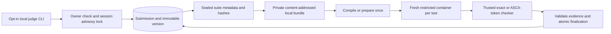

# Session 5 completion report

Implemented on 27 October 2026, continuing Session 4 commit `b3dab09f16e37bac870f63d42d5fb425564beb6f`.

## Architecture and implementation

`internal/bundles` implements immutable local storage and two six-case fixtures, each with one sample and five hidden cases. `internal/judge` implements comparison, evidence-based verdict mapping, stop-first aggregation, cleanup requirements and bounded persistence retries. `internal/execution` extends the existing Docker backend with Prepare/Run/Close; the old Execute interface still works. `internal/storage` adds suite sealing, local ownership, stable generation-one runs and transactional results. Migrations 0003/0004 add metadata, runs, sanitized evidence, relational constraints, immutable-history guards and serialization against late evidence insertion. `cmd/judge-local` is a separate trusted controller, excluded from API/worker runtime images.

The local store uses SHA-256 filenames, exclusive creation, bounded strict JSON decoding and full bundle/case metadata verification. Version bindings cannot be overwritten; inconsistent counts or hashes fail closed. Inputs and expected outputs remain in private ignored files. Runtime receives one stdin, never the full bundle or credentials. PostgreSQL stores output hashes and counts rather than raw output/diagnostics. Public API responses expose no hidden suite or detailed evidence.

Exact mode compares bytes, including trailing whitespace. Token mode splits only ASCII whitespace and compares token bytes; Unicode, invalid UTF-8, extra tokens and numeric spelling remain significant. There is no numeric tolerance. Stop-first means only the tested prefix receives rows; AC requires every case. CE includes an explicit compile reason for syntax/nonzero, timeout, output limit or confirmed OOM. Runtime 137 alone is RE, never proof of MLE. Infrastructure/cancellation/configuration/bundle/cleanup failures have no user verdict.

## Genuine execution evidence

The tagged real-judge suite passed all 11 scenarios against PostgreSQL and the existing Docker sandbox. It checks durable result rows, owner-scoped public reads, version association and terminal replay without execution for the nine base fixtures. Two additional scenarios verify empty stdin, fresh `/tmp`, new immutable versions and policy differences.

| Actual fixture | Verdict | Tests run | Passed |
|---|---|---:|---:|
| C++ sum, negative/zero/boundary cases | AC | 6 | 6 |
| Python sum, same suite | AC | 6 | 6 |
| Constant wrong output | WA | 1 | 0 |
| C++ syntax error | CE | 0 | 0 |
| Python abnormal termination | RE | 1 | 0 |
| Infinite loop | TLE | 1 | 0 |
| 512 MiB allocation in 256 MiB sandbox, confirmed OOM | MLE | 1 | 0 |
| Unbounded stdout | OLE | 1 | 0 |
| Unbounded stderr | OLE | 1 | 0 |
| Empty stdin, fresh temporary state, token whitespace | AC | 2 | 2 |
| Same output under exact bytes | WA | 1 | 0 |

The C++ AC controller counters were exactly one compilation and six runtime starts. Python AC prepared once and started six runtimes. Both preserve a read-only artifact between fresh containers. The isolated real-judge suite persisted 11 runs and 21 per-test rows before dropping its temporary schema.

The independent CLI smoke script passed all nine base fixtures through the live API and actual native CLI, followed by nine terminal replays. It verified all seven verdicts, compile-once counters, public final status and zero runtime starts on replay. PostgreSQL contained nine completed runs and exactly 18 result rows: two six-row AC runs, one zero-row CE run and six one-row failures. All 18 rows had NULL CPU/peak-memory measurements; exactly one MLE row had confirmed OOM. The C++ run ID was `a5cc54dc-4c6b-4616-a3f0-aace37056a1d`; Python AC was `739d0644-f741-408a-a242-572811bf82a1`; confirmed MLE was `9c20bd69-3fc4-4bd5-ae78-279cad573687`. Every run retained problem version 1. Final Docker label queries found zero sandbox containers and zero sandbox volumes.

## Persistence and failure validation

The real PostgreSQL atomicity test injects a result-write trigger failure. The transaction leaves submission/run RUNNING and zero result rows. Retrying the same work/report succeeds. Twenty concurrent identical finalizations produce one fresh completion and nineteen replays, with exactly six rows. A changed fingerprint, stale state version, foreign principal, terminal rewrite or metadata mutation is rejected. An actual corrupted local bundle yields FAILED with `bundle_verification_failed` and null verdict. Closed database pools cannot report successful evaluation. Unit tests separately prove bounded persistence retry executes the program only once.

Beginning creates one stable run and performs QUEUED -> RUNNING atomically. Completing performs RUNNING -> EVALUATING -> COMPLETED, inserts all evidence and completes the run in a single transaction. A result cannot become externally visible without its evidence. Available wall time/exit/OOM/image/policy are recorded; unavailable CPU time and peak memory stay SQL NULL.

## Executed validation

- `sh scripts/check.sh`: formatting, vet, all 35 unit test functions, normal and race mode, all executable builds.
- Tagged integration vet and `go test -race -tags=integration ./tests`: 19 behavioral PostgreSQL/Redis tests; one additional named subprocess helper supports the crash test. Includes the prior 50-job/four-slot/two-instance regression, process death, ACK failure, outage recovery, 20-way HTTP idempotency and CAS races.
- Native Windows `go test -c -tags=sandboxintegration` test executable: eight Docker integration functions covering 22 scenarios, plus the seven execution unit functions; all passed.
- Native Windows `go test -c -tags=judgeintegration` test executable: one real-judge function with 11 scenarios; all passed. Native runs have no race instrumentation; hosted Linux CI runs both tagged suites with `-race`.
- Docker application image build, Compose migrations/start/health, service-isolation audit, live API smoke (one create and nineteen idempotent replays), development dispatch smoke (two messages, one receipt, PEL zero; submission still QUEUED).
- No silent skips are counted as passes. Fake evidence is used only for orchestration/SQL semantics tests; the verdict table uses actual C++/Python execution.

Host environment remains Docker Desktop 29.9.2, Linux kernel `6.18.54.1-microsoft-standard-WSL2`, cgroup v2, GCC 14.3.0 and Python 3.13.17. Runtime image IDs and the verified seccomp checksum are unchanged from Session 4. Go checks run in the Go 1.26 container. Native controller executables are cross-compiled and remain ignored. A local public CA build secret handles host HTTPS inspection; no TLS verification was disabled.

CI retains both jobs. The sandbox job now provisions a loopback-only PostgreSQL adapter and runs the real judging matrix with the race detector after the existing enforcement tests. Hosted status for the pushed commit is reported in the delivery message.

## Limits and next session

This is controlled local development judging with a session advisory lock. A hard controller crash may strand RUNNING work; automatic crash reclaim, rejudging, distributed leases and fencing are absent. The independent runtime watchdog still stops computation, but abrupt host loss can leave artifacts for operator cleanup. Compilation reuse is per evaluation, not a global cache. Storage is a trusted local adapter, not replicated object storage; OS permissions do not defend against the host operator. CPU/peak-memory measurement and custom numeric checkers remain deferred. Go execution is unsupported by this controller although the existing API language contract is preserved.

API/worker defaults retain no Docker authority, real Redis consumption or automatic job publication. Session 6 should add transactional outbox delivery while preserving stable identities and atomic result semantics; distributed ownership comes later. Local learning notes remain outside Git.

See [workflow and interview explanation](local-judging.md) and [ADR 0005](adr/0005-immutable-local-judging.md).
