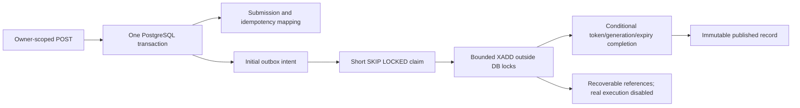

# Session 6 completion report

Implemented on 27 October 2026, continuing `808ea63720315517ad9ba1be23ec38c553d5e80c`.

## Creation invariant and files

Every newly accepted submission now commits its original owner-scoped idempotency mapping and exactly one initial dispatch intent in the same PostgreSQL transaction. Replay returns the same submission without another event, even at the admission threshold. A conflicting body remains 409. Any transaction failure rolls back submission, mapping and intent together. All existing accepted language identifiers receive an intent; automatic execution and new language support are not implied.

Migration `0005_outbox.sql` is forward-only; prior migrations are unchanged. It adds stable UUIDs, immutable submission/type/payload-version/intent-generation identity, state constraints, attempts, retry-budget base, authoritative claim generation/token/expiry, due times, safe errors, publication evidence and due/expiry/status-age indexes. The unique submission/type/intent-generation key protects initial intent while reserving space for future deliberate generations. No rejudge operation exists. Events contain references, not code, hidden tests or credentials. Deletion and published-history mutation are prohibited; there is no automatic retention cleanup or Redis trimming.

`internal/storage/submissions.go` extends the existing transaction rather than creating another submission path. `internal/storage/outbox.go` provides bounded claim/finalization/failure/statistics/operator operations. `internal/outbox` provides pacing, classification, publication and drain orchestration. `cmd/outbox-relay` supplies explicit enablement, configuration validation, migrations/startup checks, structured logging, health and bounded diagnostics. `internal/config/outbox.go` defines environment bounds. Redis `internal/queue` supports schema 2 event IDs and preserves schema 1 compatibility. Development receipts check authoritative QUEUED/state-version-zero eligibility before insertion. API backlog rejection is 503 with Retry-After, while accepted idempotency replays bypass it.

The Docker image includes the relay binary; Compose starts it only through the optional `outbox` profile and explicit enable flag. API, worker and relay receive no Docker socket, daemon endpoint or sandbox authority. The local judge CLI remains independent.

## Relay ownership, retries and backpressure

PostgreSQL atomically advances claim generation and assigns a fresh UUID token/expiry. Short indexed candidate/claim statements release locks before XADD. Conditional publication and failure recording require the same token/generation, CLAIMED state and unexpired database ownership. This fences outbox metadata only. A stale publisher can still have sent a duplicate Redis entry; it cannot overwrite a newer claim.

Schema-2 messages carry stable event UUID, submission UUID and intent generation. The attempt field is not a relay claim token or execution lease. A lost Redis reply or crash after XADD is uncertain, so recovery republishes the logical event, potentially under another Stream ID. Stable IDs and authoritative transactional consumers are required for idempotent effects. Current production real consumption remains disabled; the harness refuses real jobs without ACK, verdict or receipt. Existing receipt uniqueness and atomic evaluation finalization remain intact.

Transient/uncertain publication errors use capped exponential equal-jitter backoff and durable PENDING scheduling. Permanent schema/Redis configuration errors and exhausted budgets enter QUARANTINED with safe codes. Database iteration failures back off too. Default bounds: batch/concurrency 4 (maximum 16), claim TTL 30s, publish deadline 3s, poll 500ms, backoff 1s–1m, budget 20 attempts and drain 10s. The configured publication deadline cannot exceed a third of TTL. Expiry provides crash recovery; no claim-renewal loop is required for bounded publication.

New admission counts pending/claimed/quarantined intents under a short transaction advisory lock and bounded query, default threshold 10000. That serialization is a deliberate initial throughput tradeoff. Internal `/outboxz` and operator `--stats` expose state counts, retry count and oldest pending/claimed age. Per-state scans stop at 10001; `Capped` explicitly marks lower-bound counts. Full Session 11 observability is deferred. Published-but-unconsumed Redis storage is not included in the admission count and still requires operator capacity management.

Historical rows are not automatically backfilled. An explicitly enabled privileged `--backfill UUID` operation checks one QUEUED submission and inserts missing initial intent idempotently. `--retry EVENT_UUID` releases quarantine or an expired claim, preserves identity/lifetime attempts and starts a fresh bounded retry budget. It cannot steal a live claim or reopen published history. Unknown immutable payload versions require a compatible relay deployment before retry.

## Verified crash-window matrix

All rows below were exercised against real PostgreSQL/Redis. Faults are injected at named boundaries rather than inferred from successful normal runs.

| Point | Injection | Observed result |
|---|---|---|
| A | PostgreSQL trigger rejects outbox insert before commit | Zero submission, mapping and intent rows survived |
| B | Kill subprocess after committing through the API's repository transaction, before publication | Pending intent survived; another relay published it |
| C | TCP gate disconnects actual Redis during a 12-event backlog | Intents remained pending with retry scheduling; recovery drained all |
| D | Kill relay helper process after successful real XADD, before publication marking | Expired claim recovered; two Stream IDs carried one event UUID; no judging effect |
| E | Expire A's claim in DB, claim through B, try A's success/failure writes | Both stale writes rejected; B's generation/token remained authoritative |
| F | Kill relay process after XADD during backlog; stop/restart relay loops | Remaining and expired claims recovered; all 12 events became published |
| G | Two independent relay loops share the same real backlog | Claims distributed without lost events; no submission state mutations |
| H | Unsupported immutable payload version; actual Redis WRONGTYPE | Explicit malformed/configuration quarantine, zero false publication |
| I | Twenty concurrent identical HTTP requests | One 201, nineteen 200 replays, one submission, mapping and initial intent |
| J | Previous submission/version/receipt/evaluation suites plus main-DB inspection | All previous behavior checks passed; nine existing evaluations/18 result rows preserved |
| K | Cancel during blocked real publication, with sufficient versus expired drain | Successful drain finalized; expired drain retained a recoverable claim |
| L | RESP proxy reads successful XADD response from Redis, then drops TCP reply | Client saw uncertainty; durable intent retried; two entries had the same event UUID |

The process helper in B uses the exact repository transaction invoked by the API, not a separately killed HTTP server. D/F kill actual subprocesses. L drops an actual protocol response after Redis accepted the command, rather than merely returning a fake timeout. Real jobs delivered twice to the safe harness remained pending twice, with zero receipts and QUEUED/version-zero/null-verdict submission state. This demonstrates safe non-execution, not a completed distributed judging consumer.

## Live end-to-end evidence

Before the new API smoke, the main database contained 15 historical submissions and zero outbox intents after migration. Existing evaluations remained nine runs and 18 result rows. A controlled development API and explicitly enabled relay published to isolated `test:judgegrid:s6-outbox`.

`scripts/outbox_smoke.py` produced:

- Submission `d90182e1-276f-4d5f-97eb-b95b8b6e503b`.
- Event `cfca2443-ff55-4b3d-93d1-48ed9f209eb3`.
- Redis Stream ID `1793089325983-0`.
- Twenty POSTs: one creation, nineteen replays, one outbox record.
- Verified stored Stream ID resolves to that event/submission in actual Redis; submission remains QUEUED, state version 0 and no verdict.

Both the internal statistics endpoint and operator CLI reported pending 0, claimed 0, published 2, quarantined 0 and uncapped counts. The second published event was the new submission from the preceding API regression smoke. No historical rows were automatically dispatched. The isolated integration suite separately proved real outage/backlog recovery, crash replay and uncertain publication.

The final rebuilt application/relay repeated the live smoke successfully: submission `48175ca3-e739-403f-83fc-099441f6572b`, event `b4e145f9-1869-4d6c-bb8c-c1ee89496b64`, Stream ID `1793089649653-0`. Final diagnostics showed three published intents and no pending/claimed/quarantined work; the same nine evaluations and 18 result rows remained. After verification the optional relay was stopped, default production/development-auth-off configuration restored, and unauthenticated API denial rechecked. PostgreSQL had no published port. Final sandbox label queries found no containers or volumes.

## Executed checks

- `sh scripts/check.sh`: gofmt, vet, all executable builds, 41 normal/race unit-test functions (35 preserved plus six new).
- `go vet -tags=integration ./tests`, judge-tag vet, and `go test -race -tags=integration ./tests`: 27 behavioral PostgreSQL/Redis test functions. Two additional named subprocess helpers support crash tests and are not counted as behavioral scenarios. Includes the previous 19 and eight new tests, with additional subcases.
- Cross-compiled native Windows sandbox suite: eight Docker integration functions/22 scenarios, plus execution units; passed. A first overlapping run hit the existing test's global container-name polling while the judge suite ran concurrently. The complete sandbox suite was rerun alone and passed; execution code/security checks were unchanged.
- Cross-compiled native Windows real judge suite: all 11 scenarios passed, including actual AC/WA/CE/RE/TLE/confirmed-OOM MLE/stdout-and-stderr OLE, compile once/run six, versioning, exact/token and fresh filesystem checks. Native suites have no race instrumentation; hosted Linux CI runs them with `-race`.
- Application image build, Compose migration/start/health, live API smoke (including 20-way HTTP race), existing publisher/receipt smoke, isolated relay smoke, operator statistics, health endpoint and API/worker/relay authority audit.
- Tagged suites require explicit environment and were executed rather than silently skipped. No fake verdict generator is used.

Environment remains Docker Desktop 29.9.2, Linux WSL2 kernel `6.18.54.1-microsoft-standard-WSL2`, cgroup v2, Go 1.26 container checks and existing pinned GCC/Python runtime images. No daemon access was added to services. Hosted CI now includes the optional relay demonstration after existing API/dispatch checks; sandbox and real judging jobs remain preserved. Exact hosted outcome is reported with the delivered pushed commit.

## Limitations and Session 7 handoff

These claims own publication records, not sandbox execution. Real workers remain disabled, and no ACK pretends a submission was judged. Redis persistence/availability and PostgreSQL durability remain operational assumptions; PUBLISHED records are not automatically replayed after independent Redis data loss. Keep the destination stream stable across relays and restarts. No automatic retention, rejudging, execution leases, heartbeats, global compilation cache, frontend or AI agents were added.

Session 7 must implement authoritative worker ownership, lease renewal, takeover and result fencing before connecting real jobs to automatic execution. Worker inbox/deduplication effects must be transactional with authoritative business state. Preserve event IDs, immutable problem-version references, atomic results, hidden-test boundaries and explicit unsupported-language handling during that integration.

Operational commands and exact configuration are in [outbox operations](outbox.md); rationale is in [ADR 0006](adr/0006-transactional-outbox.md). Local session notes stay outside Git.
