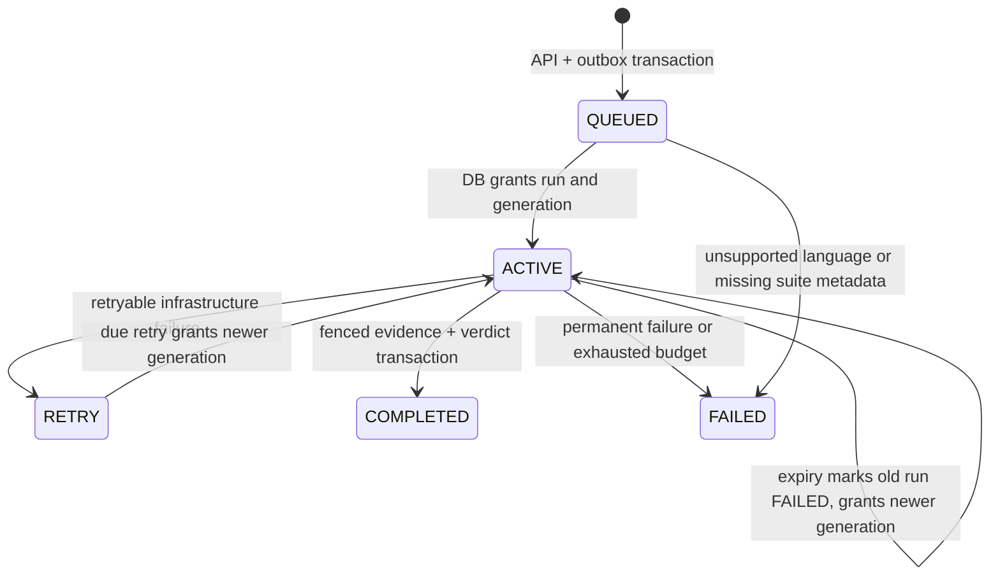
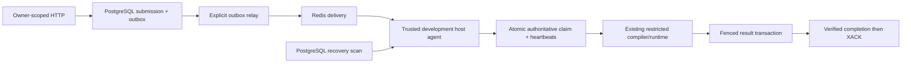

# Session 7 completion report

Implemented on 27 October 2026, continuing Session 6 commit `03a5b4efbb1598f3f5a02e07aaff9c281c2d4770`.

## Ownership model and boundaries

Forward migration 0006 extends the existing evaluation history with immutable owner identity and adds one `execution_ownership` row per submission. Its current run/submission/generation/owner composite FK points to an existing evaluation run. A primary key prevents concurrent current owners; guards reject generation regression/jumps, revival of expired ownership, owner changes during renewal and terminal rewrites. Each granted attempt creates a new existing-format evaluation run; failed/expired history is retained. `execution_rejections` records non-executable work without manufacturing a verdict or execution run.

Claims lock submission then ownership then run, resolve schema-2 event/submission/initial intent identity against a published outbox record, enforce the configured principal and supported language, and atomically grant the next generation. Redis consumer identity, stream entry ID and XAUTOCLAIM never grant authority. Duplicates with live ownership return retry without execution or ACK. Terminal replay verifies the submission/run/version/verdict and stored result fingerprint presence; report replay compares exact fingerprints. Rejudging/intent generations beyond one remain unsupported.

Default lease and independent heartbeat are 30s/10s. Renewals check run, owner, generation, processing status and unexpired PostgreSQL time. Every renewal error fails closed: cancel evaluation and allow no further unconfirmed writes. Recovery does not revive expired ownership. A real ACK-and-entry-deletion fault also verifies that the database scanner can recover after the transport reference is gone. Finalization revalidates authority using the database, not cached heartbeat success. The existing local CLI also receives a bounded 180s lease plus its advisory lock; historical terminal rows stay readable and immutable.

All authoritative result paths now fence: per-test inserts, evaluation completion, submission verdict/status, infrastructure failure and ownership disposition. Transaction-local owner/run/generation settings and database triggers check the current row and expiry at writes. Final results/evidence remain atomic. An old result or FAILED write after takeover cannot insert partial evidence or overwrite a newer verdict. Existing generic transition calls cannot mutate an actively owned submission without the fence.

The state diagram's ACTIVE/RETRY labels describe ownership; workflow status stays RUNNING/EVALUATING across infrastructure retries. This preserves the existing guarded submission state machine. The recovery scanner selects bounded due/expired ownership or published unowned QUEUED work for the authorized principal. It does not require an extant Redis entry, pending delivery or successful idle transfer. An expired attempt is immutably FAILED/lease_expired before takeover. Retry budgets are fixed at first grant, default three and maximum five. User-code verdicts are terminal, not infrastructure retries.

## Trusted execution agent and ACK behavior

`cmd/judge-agent` is an opt-in host executable requiring a CLI flag, `JUDGE_AGENT_ENABLED=true`, development identity and isolated dev:/test: stream. It checks pinned images and cgroup/seccomp capability before accepting work. It reuses the existing worker pool, Redis contract, evaluator and restricted Docker backend. Pool and scanner share bounded admission. Heartbeat runs independently throughout compile/run/persistence. On shutdown, polling stops, work drains within policy, then unfinished work cancels with lease/retry recovery intact.

A valid different owner never causes a competing execution or premature ACK. Completed durable work can ACK on replay without execution. Redis outage can delay ACK while the committed database result remains authoritative. Explicit durable unsupported/exhausted outcomes can ACK without implying judging success. Ordinary API, worker and relay containers retain no Docker socket/daemon authority and omit judge-agent, judge-local and sandbox-demo binaries. Default production/public automatic execution remains disabled.

## Verified fault outcomes A–T

| Scenario | Actual validation/outcome |
|---|---|
| A | Twenty concurrent PostgreSQL claimants produced exactly one owner/generation-one run |
| B | Matching heartbeat extended the database lease |
| C | Wrong owner and wrong generation could not renew |
| D | Actual elapsed lease expiry could not be resurrected |
| E | Takeover atomically advanced generation and retained failed old history |
| F | Old-owner result rejected; zero stale per-case rows; newer result committed |
| G | Old-owner infrastructure FAILED write rejected after takeover |
| H | Duplicate physical Redis deliveries produced one authoritative evaluation and were eventually ACKed |
| I | Kill actual worker subprocess after claim; recovery completed under generation 2 |
| J | Kill subprocess during real sandbox execution; independent watchdog bounded the old workload, identified artifacts were cleaned, generation 2 recovered |
| K | Kill subprocess after evaluator returned but before result transaction; newer generation completed |
| L | Kill subprocess after actual commit before XACK; same durable generation replayed/ACKed with zero new runtime starts |
| M | Real PostgreSQL TCP gate dropped heartbeat connectivity; evaluation canceled, zero evidence persisted, generation 2 recovered after expiry |
| N | Real Redis TCP gate failed after claim; database verdict committed, ACK recovered, no reexecution |
| O | Three actual worker-process deaths for one submission exhausted its immutable three-attempt budget; no fourth execution; separate DB test covered retryable infrastructure failure budget |
| P | Sufficient execution drain committed real AC; expired drain retained unfinished work with no verdict and restart recovered |
| Q | Genuine automatic C++ AC/WA/CE and Python AC/RE/TLE through the existing evaluator/backend |
| R | Accepted Go language became durable unsupported_language rejection, FAILED/null verdict, zero fabricated evaluation runs |
| S | API/ordinary worker/relay configuration and image-copy audit retained no controller/daemon authority |
| T | Previous hidden-data/measurement checks preserved; stale rewrites rejected; public smoke exposed no hidden suite/evidence |

Claim/fence SQL tests use synthetic sanitized reports solely to test transaction semantics. Verdict demonstrations use actual C++/Python and Docker. Crash helpers receive real Redis deliveries before claims and are killed at explicit process boundaries. The during-execution watchdog fixture sleeps beyond its runtime limit; takeover produces genuine TLE. The parent removes only that known execution's stopped containers/volume after verifying termination. No production sandbox security guarantee is claimed.

## Real host CLI demonstration

The actual `judge-agent` executable ran on the trusted Windows host with its existing Docker permissions, fresh authorized principal `aman-s7-auto`, private seeded bundles and isolated stream `test:judgegrid:s7-live`. `scripts/agent_smoke.py` POSTed through the live API, waited for outbox/Redis/agent completion and read owner-scoped public results:

| Fixture | Submission | Observed result |
|---|---|---|
| C++ correct | `846931e7-7562-4311-9def-dc36e907c6cb` | AC, six case rows |
| C++ wrong | `5e940e76-2a72-4433-b9bd-d68f80c1a0de` | WA, one row |
| C++ syntax | `f33d7830-a16e-4564-9078-1065aca188c7` | CE, zero runtime rows |
| Python correct | `2c28e250-8e53-4bcd-a032-8b30c70c434f` | AC, six rows |
| Python abnormal | `c1cbc5e7-5135-4f34-920f-a0168e92dc82` | RE, one row |
| Python loop | `a1d0159e-3c06-481b-a1a1-fba468e8431e` | TLE, one row |
| Unsupported Go | `96e1fdf9-170f-42aa-872f-daac6a8df3c1` | FAILED, null verdict, unsupported_language rejection |

All six genuine evaluations used generation 1 and ownership DONE; result rows totaled 15. The seven-delivery PEL reached zero. The existing nine historical evaluation runs were present before the demo, with zero ownership rows automatically manufactured for them. Old immutable versions/bundles were retained. CPU/peak-memory fields remain null when unavailable; no fabricated timings were added. The C++ compile-once/run-many and full AC/WA/CE/RE/TLE/MLE/OLE semantics also passed the existing 11-case real-judge suite.

Final inspection found 33 total result rows, all with unavailable CPU/peak-memory fields still NULL, and the same nine historical unleased runs. The host agent and relay were stopped, default production/development-auth-off settings restored, and unauthenticated API denial rechecked. Neither PostgreSQL nor Redis retained a published port. Sandbox container/volume label queries returned no leftovers. Learning notes remained ignored and untracked.

## Executed checks and counts

- Formatting, normal/race Go tests, vet and executable builds: 44 unit-test functions, preserving all prior 41 plus three agent tests.
- Real PostgreSQL/Redis `integration` suite: 32 behavioral test functions, preserving prior 27 plus five ownership/fencing/budget tests. Two subprocess helpers are infrastructure, excluded from behavioral counts. The 20-way HTTP idempotency race, outbox crash/uncertainty tests and 50-job/four-slot distribution regression passed.
- Existing sandbox suite: eight integration functions/22 scenarios plus execution units, passed sequentially on the trusted native controller.
- Existing real judge suite: 11 scenarios passed with fenced local paths, including confirmed-OOM MLE and both output limits.
- New trusted-agent suite: six behavioral functions/16 scenarios (seven pipeline fixtures, four process boundaries, two connection-outage cases, two drain cases and one repeated-process-crash budget case). Its subprocess helper and existing judge unit functions are not additional agent scenarios.
- Tagged agent/judge vet, application image build, Compose migration/start/health, live host executable/API/outbox/Redis demonstration, authority audit and resource inspection.

Native Windows suites are cross-compiled through the Go 1.26 container without Docker authority in the build container. Native sandbox/agent runs have no race instrumentation; hosted Linux CI runs all tagged suites sequentially with `-race`. Environment remains Docker Desktop 29.9.2, WSL2 Linux kernel `6.18.54.1-microsoft-standard-WSL2`, cgroup v2 and the prior pinned GCC/Python runtime images. Local public CA build secrets were used where required; TLS verification stayed enabled. No skipped suite is reported as passed. Hosted status is reported for the delivered pushed commit.

## Remaining limits and Session 8

This is development execution for an explicitly configured principal and isolated stream, not a public multi-tenant judge. A single heartbeat error intentionally sacrifices availability and may cause another physical attempt. An early 100ms test heartbeat hit its 50ms deadline under Windows load and correctly failed closed; the native fault suite uses 3s/500ms, while operational defaults remain 30s/10s. Fencing, not successful cancellation, protects effects.

Forced controller death may leave stopped resources or temporary policy files; independent watchdogs bound computation, and tests clean their own named artifacts. No automatic orphan reaper, authenticated remote execution service, automatic rejudge, compilation cache, frontend or AI agent was added. Legacy unleased RUNNING records and abandoned local-mode one-shot work require operator investigation. Initial dispatch intent generation one is the only executable generation; no lease-override/reopen command bypasses history.

Session 8 should harden Linux sandbox security and artifact/process lifecycle while preserving lease identity, immutable suites, output secrecy, explicit opt-in and fenced atomic results. Review kernel/container isolation limitations without presenting local Docker as a production hostile-code guarantee. See [agent operations](execution-agent.md) and [ADR 0007](adr/0007-execution-leases-and-fencing.md).
